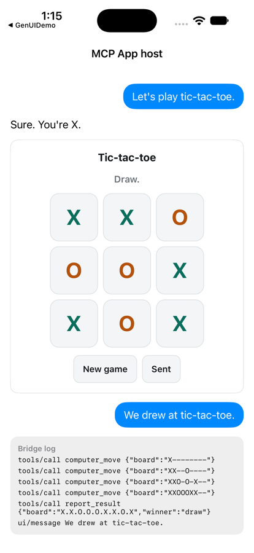

# SwiftMCPAppHost

Show **MCP Apps** in a native iOS app. SwiftMCPAppHost is a Swift host for the [MCP Apps](https://modelcontextprotocol.io/extensions/apps/overview) extension: it renders the interactive HTML interface an MCP tool returns in a locked-down `WKWebView`, and connects it to your app over the MCP Apps JSON-RPC protocol. SwiftUI and UIKit. Zero dependencies.



- **Spec-exact:** MCP Apps (SEP-1865), stable version `2026-01-26`: the `ui/initialize` handshake, tool input and results, `tools/call`, `ui/open-link`, `ui/message`, display modes, size changes, and teardown.
- **Sandboxed by default:** the app's HTML is treated as untrusted. CSP built from the resource's declared domains, network blocked outside them, no persistent storage, no navigation, no new windows, no camera or microphone.
- **Unchanged apps:** MCP Apps written for web hosts run as they are. Tested with an app built on the official `@modelcontextprotocol/ext-apps` SDK (2.0.4): handshake, tool input and result, tool calls, messages, links, model context, display modes, logging and teardown.
- **Bring your own MCP client:** this package hosts the interface; your client makes the tool calls.
- **Swift 6:** strict concurrency, tested under Thread Sanitizer.

## Installation

In Xcode, choose File ▸ Add Package Dependencies, or add it to `Package.swift`:

```swift
.package(url: "https://github.com/zhaziragaripolla/SwiftMCPAppHost.git", from: "0.1.0"),
```

iOS 17+ (macOS 14+ for running the tests).

## Quick start

**1. Tell MCP servers you can show apps.** Add this to the capabilities in your MCP client's `initialize` request:

```swift
let capabilities: MCPJSON = ["extensions": MCPAppProtocol.clientCapability]
```

**2. Implement the delegate.** Only `callTool` is required. Everything else is refused unless you implement it.

```swift
import SwiftMCPAppHost

@MainActor
final class AppHost: MCPAppHostDelegate {
    let client: MyMCPClient
    init(client: MyMCPClient) { self.client = client }

    // Required: the app called a tool on its server. Forward it through your MCP client.
    func callTool(name: String, arguments: MCPJSON?) async throws -> MCPJSON {
        try await client.callTool(name: name, arguments: arguments)
    }

    // Optional: everything else is refused by default.
    func openLink(_ url: URL) async -> Bool {
        // e.g. await UIApplication.shared.open(url) on iOS
        true
    }
}
```

**3. When a tool with a UI is called, show its app.** A tool declares its interface in `_meta.ui.resourceUri`.

```swift
// 1. Read the tool's UI resource (its _meta.ui.resourceUri) with your MCP client.
let resource = try MCPAppResource(readResult: try await client.readResource(uri: uiURI))

// 2. Create a host for it.
let host = MCPAppWebHost(
    resource: resource,
    hostInfo: MCPAppHostInfo(name: "MyApp", version: "1.0"),
    delegate: appHost
)

// 3. Pass the tool call through. Held until the app finishes its handshake.
host.bridge.sendToolInput(arguments)
host.bridge.sendToolResult(callToolResult)
```

**4. Put it on screen.**

```swift
MCPAppView(host: host, maxHeight: 500)          // SwiftUI
let view = MCPAppHostView(host: host)           // UIKit
```

The view sizes itself to the height the app reports, up to `maxHeight`.

**5. Before removing it:**

```swift
await host.teardown()
```

These snippets are compiled and run in the test suite (`Tests/SwiftMCPAppHostTests/DocumentationSnippetTests.swift`).

## What your delegate can handle

| App request | Delegate method | Default |
|---|---|---|
| `tools/call` | `callTool(name:arguments:)` | Required |
| `resources/read` | `readResource(uri:)` | Refused |
| `ui/open-link` | `openLink(_:)`; only `http`, `https` and `mailto` URLs reach it | Refused |
| `ui/message` | `receiveMessage(_:)` | Refused |
| `ui/update-model-context` | `updateModelContext(_:)` | Ignored |
| `ui/request-display-mode` | `requestDisplayMode(_:current:)` | Stays in the current mode |
| `notifications/message` | `didReceiveLog(_:)` | Ignored |
| `ui/notifications/request-teardown` | `appDidRequestTeardown()` | Ignored |
| Anything the host dropped or blocked | `didReport(_:)` | Ignored |

From the host side, `host.bridge` sends `sendToolInputPartial`, `sendToolInput`, `sendToolResult`, `sendToolCancelled`, and `setHostContext` (only changed fields are sent). Notifications sent before the app finishes its handshake are held and delivered afterwards, as the spec requires.

## Security model

The app's HTML comes from a third-party server, so it's treated as untrusted:

- **Content Security Policy** from the resource's `_meta.ui.csp`, built as the spec describes. With none declared, the spec's default: no network, inline scripts and styles only. Declared domains must be plain `https://` or `wss://` origins; anything else is dropped and reported.
- **Network rules:** a WebKit content rule list blocks every load outside the declared domains, in addition to the CSP.
- **No persistent data:** each app gets a non-persistent data store.
- **No navigation:** the app can't load another page; link taps go to your delegate.
- **No new windows, no camera, microphone or location.** Requested permissions are reported, not granted.
- **One channel:** only messages from the app's main frame, through one handler, that are valid JSON-RPC, under 1 MB.
- **Timeouts** on the handshake (15 s) and on host requests.

The reasoning for each control is in [RFC-001](Docs/RFCs/RFC-001-native-mcp-apps-host.md).

## Limits

- It doesn't include an MCP client. Pair it with one, such as the official Swift MCP SDK.
- Display mode changes are reported to your delegate; presenting fullscreen or picture-in-picture is up to you.
- Permissions (camera, microphone, geolocation, clipboard) are never granted.
- Apps that post messages to their own window (not their parent) won't work, because that path carries the protocol.
- iOS is the target. macOS builds and runs the tests; the UIKit view is iOS-only.

## Example

`Examples/TicTacToe` is a native chat that hosts MCP Apps. It runs with no network and no API key.

- **Tic-tac-toe:** a hand-written app. It calls a `computer_move` tool on each turn, reports the result, and can send a message to the conversation.
- **Official SDK:** an app built with `@modelcontextprotocol/ext-apps`, with a button for each request type. Generate it first; it isn't committed because it bundles the SDK, which has its own license:

```bash
python3 Examples/TicTacToe/Scripts/make-sdk-probe.py
```

```bash
cd Examples/TicTacToe && xcodegen generate && open TicTacToe.xcodeproj
```

## For AI coding assistants

- [`llms.txt`](llms.txt) and [`llms-full.txt`](llms-full.txt) describe the package for language models.
- A Claude Code plugin with a skill for this package is in [`plugins/swift-mcp-app-host`](plugins/swift-mcp-app-host). Install it with:

```
/plugin marketplace add zhaziragaripolla/SwiftMCPAppHost
/plugin install swift-mcp-app-host@swift-mcp-app-host
```

## Development

```bash
swift test
```

## License

MIT. See [LICENSE](LICENSE).
